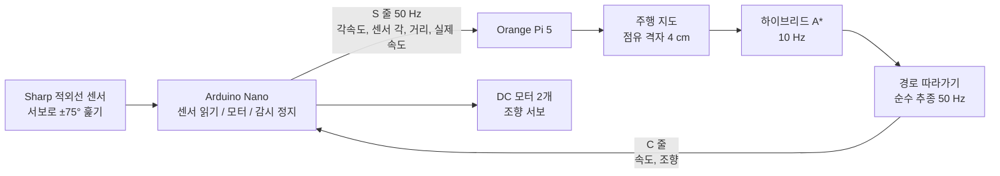

# 코드 보고서: 사전 지도 없는 자율주행 RC카

> 팀 Tesla / 2026학년도 2학기 자산어보 창의융합 프로젝트 / 짧게 보려면 [1쪽 요약](CODE_SUMMARY.md)
>
> 최종 보고서에 다 담지 못한 **코드의 구조와 변천사**를 정리한 문서다. 보고서는 "무엇을 알아냈나", 이 문서는 "코드가 어떻게 생겼고 왜 지금 모양이 되었나"를 다룬다.

---

## 목차

0. [한눈에 보기](#0-한눈에-보기)
1. [전체 구조](#1-전체-구조)
2. [변천사 타임라인](#2-변천사-타임라인)
3. [1단계: 원과 접선 기하 모델](#3-1단계-원과-접선-기하-모델)
4. [2단계: 접선 그래프](#4-2단계-접선-그래프)
5. [3단계: 하이브리드 A\*로 전환](#5-3단계-하이브리드-a로-전환)
6. [4단계: 실제 차로 옮기며 고친 코드](#6-4단계-실제-차로-옮기며-고친-코드)
7. [시험 코드](#7-시험-코드)
8. [차에서 돌리기](#8-차에서-돌리기)
9. [배운 것과 남은 것](#9-배운-것과-남은-것)

---

## 0. 한눈에 보기

| 항목 | 값 |
|---|---|
| 언어 | Python 3 (계산 보드, 시뮬레이터), C++ (Arduino 펌웨어) |
| 계산 보드 | Orange Pi 5 (경로 탐색 평균 8.3 ms, 목표 100 ms) |
| 마이크로컨트롤러 | Arduino Nano (모터, 서보, 센서, 감시 정지) |
| 코드 양 | 약 8,500줄 (`rccar/` 약 6,600줄 + 펌웨어 약 620줄 + 실행, 시험 파일 약 1,300줄) |
| 자동 시험 | 67개 (`python -m pytest tests`) |
| git 기록 | 2026-10-08부터. 그 전(9월) 작업은 첫 커밋에 한꺼번에 들어 있다 |

**빠른 실행**

```bash
pip install -r requirements.txt
python run.py                      # 시뮬레이터에서 무작위 지도 주행
python run_circle_model.py         # 1단계 기하 모델 1000개 시험
python run_arena_check.py          # 실제 차 크기로 가상 시험장 30개
python -m pytest tests             # 자동 시험 67개
```

---

## 1. 전체 구조

### 1.1 데이터 흐름



차가 달리는 동안 이 고리가 계속 돈다. **사전 지도는 없고**, 지도는 센서 값으로 달리면서 만든다.

### 1.2 파일 지도

| 파일 | 하는 일 |
|---|---|
| `rccar/circle_model.py` | 1단계. 판별식, 수선의 발, 접선으로 원을 비켜 가는 기하 모델 |
| `rccar/circle_avoider.py` | 1단계 모델로 실제 주행을 흉내 냄 |
| `rccar/planner.py` | 2단계. 접점을 역으로, 접선과 호를 노선으로 한 그래프 + 지연 평가 A\* |
| `rccar/hybrid.py` | 3단계. 하이브리드 A\* (위치와 방향을 함께 탐색) |
| `rccar/hybrid_sim.py` | 하이브리드 A\* 시뮬레이터 주행, 경로 추적기 |
| `rccar/grid.py` | 점유 격자 지도 (센서 빛을 칸에 칠하기) |
| `rccar/sensors.py`, `perception.py` | 거리 센서 모델, 측정값을 점과 물체로 묶기 |
| `rccar/vehicle.py`, `controller.py` | 자전거 모형 차량, 순수 추종 제어 |
| `rccar/robot.py` | **실제 차의 두뇌.** 시뮬레이터와 같은 탐색 코드를 실제 센서 값으로 돌림 |
| `rccar/link.py` | 계산 보드와 Arduino 사이 글자 통신 (검사값 포함) |
| `rccar/fake_arduino.py` | 가짜 Arduino. 실제 차 없이 `robot.py`를 시험함 |
| `rccar/car_specs.py` | 잰 차 치수를 한곳에 모음 |
| `rccar/error_split.py` | 오차 분해 (알고리즘, 센서, 위치 추정의 몫) |
| `firmware/rccar_arduino/` | Arduino 펌웨어 |
| `run_robot.py`, `scripts/start_car.sh` | 차에서 실제로 도는 프로그램, 부팅하면 자동 시작 |

### 1.3 설계 원칙: 시뮬레이터와 실제 차가 같은 코드를 쓴다

`robot.py`는 `link` 하나만 바꿔 끼운다. 진짜 USB(`SerialLink`)를 넣으면 실제 차, 가짜 Arduino(`FakeArduino`)를 넣으면 시뮬레이터다. 그래서 "시뮬레이터에서는 됐는데 실제 차에서는 다른 코드가 돈다"는 일이 없다. 4단계에서 찾은 버그 대부분을 가짜 Arduino로 먼저 재현하고 고칠 수 있었던 이유다.

```python
# run_robot.py (실제 차)
link = SerialLink(args.port)
rb = Robot(link, goal_local, veh=veh, wait_for_goal=args.wait_goal, **settings)

# run_arena_check.py (가상 시험장)
fake = FakeArduino(world, start, veh=car, rng=np.random.default_rng(seed), ...)
robot = Robot(fake, goal_local, veh=car, ...)
```

### 1.4 통신 형식

사람이 시리얼 모니터로 읽을 수 있게 **글자로** 주고받는다. 초당 2 KB도 안 되므로 압축할 필요가 없다. 줄 끝의 `*XX`는 앞 글자들을 XOR한 검사값이고, 안 맞으면 버린다.

```text
Arduino -> Pi   S,<ms>,<각속도x100>,<센서각x10>,<앞거리mm>,<뒤거리mm>,<실제속도mm/s>,<플래그>*CS
Arduino -> Pi   G,<cm>*CS                     손 출발. 지금 보는 방향으로 cm 앞이 목적지
Pi -> Arduino   C,<속도mm/s>,<조향x10>*CS     0.3초 안에 다음 C가 안 오면 Arduino가 스스로 정지
Pi -> Arduino   B,<on>*CS                     부저
```

---

## 2. 변천사 타임라인

| 시기 | 단계 | 무엇을 했나 | 왜 다음으로 넘어갔나 |
|---|---|---|---|
| 9월 | 1단계 기하 모델 | 원을 판별식으로 판정하고 접선으로 비켜 감 | 원끼리 겹치면 실패. 1000개 중 981 도착, 16 충돌 |
| 9월 | 2단계 접선 그래프 | 모든 접점을 이은 그래프에서 A\* | 최소 회전 반경과 통로 폭을 함께 못 다룸 |
| 9월 | 3단계 하이브리드 A\* | 차가 그릴 수 있는 곡선만 이어 붙임 | 시뮬레이터에서 안정. 실제 차로 |
| 10-08 | git 시작 | 지금까지를 첫 커밋으로 기록 | |
| 10-19 ~ 10-27 | 실물 준비 | 차 치수, 오차 분해 도구, 샤프 센서, 모터 드라이버, 보드 배포 | |
| 10-27 | 작은 차 설정 | 48 cm 차 설정을 22 cm 차, 1.5 m 시험장에 맞춤 | 가상 시험장 28/30 도착 |
| 10-28 | 실물 버그 잡기 | 하루에 버그 10개 넘게. 센서 방향, 자이로 눈금, 조향 방향 등 | 6장 |
| 10-28 | 자이로 고장 대응 | Arduino가 자이로 대신 회전 빠르기를 계산 | 실제 주행 영상 |
| 10-30 | 보고서 | 보고서 PDF 자동 생성, 이 문서 | |

---

## 3. 1단계: 원과 접선 기하 모델

> 파일: `rccar/circle_model.py`, 실행: `python run_circle_model.py`

장애물을 원으로, 차를 점으로 본다(원의 반지름에 차 폭의 절반을 더해 부풀림). 목적지로 가는 직선이 원을 지나는지 **공통수학2의 판별식**으로 판정한다.

```python
def discriminant(line, circle):
    """직선의 식을 원의 방정식에 대입한 이차방정식의 판별식 D.

    y = mx + k 를 (x - a)^2 + (y - b)^2 = r^2 에 넣으면
      (1 + m^2) x^2 + 2(m(k - b) - a) x + a^2 + (k - b)^2 - r^2 = 0
    """
    a, b, r = circle
    if line.is_vertical:
        return 4.0 * (r * r - (line.vertical_x - a) ** 2)
    m, k = line.slope, line.intercept
    quad = 1.0 + m * m
    lin = 2.0 * (m * (k - b) - a)
    const = a * a + (k - b) ** 2 - r * r
    return lin * lin - 4.0 * quad * const
```

판별식은 **직선 전체**를 보므로, 차 뒤쪽이나 목적지 너머의 원까지 걸린다. 그래서 **수선의 발**이 출발점과 목적지 사이에 있는지도 같이 본다.

```python
def segment_hits_circle(start, end, circle):
    if is_inside(start, circle) or is_inside(end, circle):
        return True
    line = line_through(start, end)
    if not line_cuts_circle(line, circle):          # D > 0 이 아니면 안 지남
        return False
    foot = foot_of_perpendicular((circle.x, circle.y), line)
    return is_between(foot, start, end)             # 수선의 발이 선분 위에 있어야 지남
```

**한계:** 부풀린 원끼리 겹치는 배치에서는 접선이 다른 원 안으로 들어간다. 1000개 중 겹치지 않은 415개는 모두 통과했지만, 실패 19개는 전부 겹치는 배치였다. 벽처럼 늘어선 기둥에서는 좌우를 57번 바꾸며 진동했다.

---

## 4. 2단계: 접선 그래프

> 파일: `rccar/planner.py`

원 하나씩 보지 않고, **모든 접점을 역**, 접선과 호를 **노선**으로 삼아 지하철 노선도 같은 그래프를 만든 뒤 A\*로 가장 싼 경로를 찾는다.

### 4.1 지연 충돌 검사: 2,253 ms에서 24 ms로

노선이 5,709개라 전부 미리 충돌 검사하면 한 번 계획에 2초가 넘었다. 그래서 그래프를 만들 때는 검사하지 않고, **A\*가 그 노선을 실제로 꺼낼 때만** 검사한다. 길이(하한)로 먼저 줄을 세우고, 꺼냈을 때 실제 비용이 더 비싸면 다시 넣는다. 하한이 실제 비용을 넘지 않으므로 결과는 전부 검사한 것과 **똑같다**(경로 비용 32.02로 소수점까지 같음).

```python
while openq:
    _, g0, _, u, parent, eidx = heapq.heappop(openq)
    if u in closed:
        continue
    if parent >= 0:
        ok, true_cost = self.evaluate(eidx)       # 이때 처음으로 충돌 검사
        if not ok:
            continue                              # 부딪히면 버림
        g_true = closed[parent] + true_cost
        if g_true > g0 + 1e-9:                    # 하한보다 비쌌다 -> 다시 줄 세움
            heapq.heappush(openq, (g_true + h(u), g_true, cnt, u, parent, eidx))
            continue
```

평균 25개만 검사하고 끝났다. **약 90배** 빨라졌다.

### 4.2 뒤로 되돌아가는 경로: 금지가 아니라 벌점

탐색이 차의 방향을 몰라서 차 뒤쪽으로 출발하는 경로를 자주 골랐다. 세 번 시도했다.

| 시도 | 결과 |
|---|---|
| 반대쪽 우회로를 아예 안 만듦 | 멀쩡한 우회로까지 막혀 주행 시간 증가 |
| 뒤로 가는 첫 구간 금지 | 막다른 골목에서 못 빠져나옴 |
| **뒤로 갈수록 큰 벌점** | 둘 다 해결. 되돌아가기 30회에서 0회, 41.3초에서 18.0초 |

```python
def _back_cost(self, u, v):
    """금지가 아니라 벌점인 이유: 막다른 골목에서는 돌아 나오는 것이 유일한 정답이라,
    아예 막으면 빠져나올 수 없다. 비싸게 만들어 두면 그것밖에 없을 때만 고른다."""
    ...
    c = (cos(self.heading) * dx + sin(self.heading) * dy) / n   # 차 방향과 이루는 각의 코사인
    if c >= 0.0:
        return 0.0                                              # 앞쪽이면 벌점 없음
    return self.P.w_back * self.rho * (-c)                      # 정반대일수록 커짐
```

벌점 크기를 12, 30, 60, 120으로 바꿔 보니 **어중간한 값(30, 60)이 가장 나빴다.** 그래서 120을 쓴다.

**한계:** 접선 그래프의 경로는 차가 실제로 그릴 수 없는 꺾임을 만들 수 있고, 최소 회전 반경과 통로 폭을 동시에 다루지 못했다. 그래서 3단계로 넘어갔다.

---

## 5. 3단계: 하이브리드 A\*로 전환

> 파일: `rccar/hybrid.py`, `rccar/hybrid_sim.py`

Dolgov 외(2008)가 DARPA 도시 자율주행 대회에서 쓴 방법이다. 격자로 탐색 범위를 줄이되, 각 칸 안에서 **차의 실제 위치와 방향**을 기억하고, 차가 실제로 그릴 수 있는 **곡선 조각**(직진, 좌우로 조금씩 꺾기)만 이어 붙인다.

| 접선 그래프 | 하이브리드 A\* |
|---|---|
| 차를 점으로 봄 | 차체를 원 3개로 덮어 봄 (`Footprint`) |
| 꺾인 경로가 나올 수 있음 | 차가 그릴 수 있는 곡선만 나옴 |
| 원 모양 장애물만 | 격자 지도에 칠해진 어떤 모양이든 |

```python
# 노드: x, y, 방향, 전진/후진, 곡률, 지금까지 비용, 부모, 조각, 지켜야 할 최소 여유
nodes = [(sx, sy, sth, 0, 0.0, 0.0, -1, -1, req0)]
...
# 같은 칸, 같은 방향 구간이면 한 번만 펼침. 이게 '하이브리드'인 이유
key = (int((x - self.ox) / P.xy_res), int((y - self.oy) / P.xy_res),
       int((th % tau) * bins_th), d0)
```

충돌 판정은 매번 칸을 뒤지지 않고, 지도를 바꿀 때마다 한 번 만든 **거리장**(각 칸에서 가장 가까운 장애물까지 거리)을 읽어서 한다. 그래서 실제 계산 보드에서 한 번 탐색이 평균 8.3 ms다.

---

## 6. 4단계: 실제 차로 옮기며 고친 코드

시뮬레이터에서 통과한 코드를 실제 차에 올리자, 시뮬레이터가 "당연히 맞다"고 가정한 것들이 하나씩 깨졌다. 아래는 **git 기록에 남은 실제 수정**이다. 각 항목은 `증상 -> 원인 -> 수정 -> 결과` 순서다.

### 6.1 지도가 거울처럼 뒤집힘 (`32c3a97`)

- **증상:** 왼쪽 기둥이 지도 오른쪽에 찍힘. 센서 서보 왼쪽만 0.8배 보정을 걸었더니 오른쪽이 줄어서 알게 됨
- **원인:** 서보는 각도를 키우면 오른쪽으로 도는데, 코드는 왼쪽을 양수로 씀

```diff
+// 이 차의 센서 서보는 각도를 키우면 오른쪽으로 돎. 코드는 왼쪽을 양수로 쓰므로 서보에 줄 때만 뒤집음.
+const int SWEEP_SERVO_DIR = -1;
-      sweepServo.write(constrain(SWEEP_CENTER_DEG + gain * sweepDeg, 0, 180));
+      sweepServo.write(constrain(SWEEP_CENTER_DEG + SWEEP_SERVO_DIR * gain * sweepDeg, 0, 180));
```

### 6.2 장애물이 15° 옆에 찍힘 (`39dfd77`)

- **원인:** 거리를 재자마자 서보를 다음 방향으로 돌리는데, 보고할 때는 **다음에 갈 방향**을 같이 보냄

```diff
+// frontMM 을 잰 방향. 재자마자 서보를 다음 방향으로 돌리므로 sweepDeg 와 따로 둬야 함.
+int   measuredDeg = 999;
-                   millis(), (int)(gyroDps * 100.0), (int)(sweepDeg * 10),
+                   millis(), (int)(gyroDps * 100.0), measuredDeg * 10,
```

### 6.3 가는 기둥이 지도에서 지워짐 (`39dfd77`)

- **증상:** 가상 시험장 30개 중 기둥에 닿은 5번 가운데 3번은, 닿는 순간 그 기둥이 지도에 없었음
- **원인 두 개:**
  1. Arduino는 한 번 잰 값을 다음 측정까지 0.09초 동안 매 줄마다 되풀이해 보내는데, 계산 보드가 그걸 매번 지도에 칠함. 한 번의 "못 맞힘"이 4~5번 칠해짐
  2. "비었음"은 빛이 퍼진 호 전체에 칠하고, "막힘"은 가운데 한 점에만 칠함

```diff
-        self._add_measurement(self.front, s.sweep_rad, s.front_m)
+        measured = abs(s.sweep_rad) <= math.pi          # 아직 한 번도 안 쟀으면 펌웨어가 999 도를 보냄
+        new_reading = measured and s.sweep_rad != self._last_sweep_rad
+        self._last_sweep_rad = s.sweep_rad
+        if new_reading:                                 # 새로 잰 것만 한 번 칠함
+            self._add_measurement(self.front, s.sweep_rad, s.front_m)
```

```diff
-        if len(oe):
+        # 막힘도 시뮬레이터와 똑같이 빛이 퍼진 호 전체에 칠함
+        if sensor.map_arc:
+            ao, ae, aw, ak = sensor.occupied_for_map(m, self.grid.res)
+            if len(ae):
+                integrate_rays(self.grid, G.compose(self.pose, ao), G.compose(self.pose, ae),
+                               mark_free=False, occupied=True, occ_weight=aw, groups=ak)
+        elif len(oe):
```

**결과:** 가상 시험장 도착 28/30, 접촉 0.

### 6.4 Arduino가 통째로 얼어붙음 (`df083c7`)

- **증상:** 선을 건드리면 센서가 멈추고 보고가 0줄이 됨
- **원인:** 자이로(I2C)가 순간 끊기면 `Wire` 라이브러리가 대답을 **무한히** 기다림

```diff
+  // 자이로가 3 ms 안에 대답 안 하면 포기하고 넘어감. 끝의 true 는 I2C 를 초기화하라는 뜻
+  Wire.setWireTimeout(3000, true);
```

```diff
+  // 시간 초과로 포기했으면 받은 값이 없음. 0 편향 근처 값을 돌려줘 방향이 튀지 않게 함
+  if (Wire.getWireTimeoutFlag() || Wire.available() < 2) {
+    Wire.clearWireTimeoutFlag();
+    gyroFailed = true;
+    return (int16_t)gyroBias;
+  }
```

### 6.5 차가 도는 양이 8배로 계산됨 (`d964a46`)

- **증상:** 손으로 90° 돌렸더니 663°로 찍힘. 가만히 있어도 초당 83° 돈다고 믿어 지도가 빙글빙글 돌며 칠해지고 모든 길이 막힘
- **원인:** 자이로 범위를 설정하지 않아 기본 범위(±250°/s, 눈금 131)로 일하는데, 펌웨어는 ±2000°/s의 눈금(16.4)으로 나눔. 131 / 16.4 = 8배. 게다가 판이 뒤집혀 달려 부호도 반대

```diff
-  // ---- 자이로 (도/초). 2000 도/초 범위 기준 눈금 16.4
-  gyroDps = (mpuRawZ() - gyroBias) / 16.4;
+const uint8_t GYRO_RANGE_500 = 0x08;      // GYRO_CONFIG(0x1B) 의 FS_SEL=1
+const float   GYRO_LSB_PER_DPS = 65.5;
+const int     GYRO_DIR = -1;              // 판이 뒤집혀 달림
+  mpuWrite(0x1B, GYRO_RANGE_500);          // 범위를 직접 정함
+  gyroDps = GYRO_DIR * (gyroRaw - gyroBias) / GYRO_LSB_PER_DPS;
```

### 6.6 차가 나선을 그리며 감겨 들어감 (`0f7ec4d`)

- **증상:** 방향을 바로잡으려 할수록 더 틀어짐
- **원인:** 주행 기록을 보니 오른쪽 24~32°를 보낼 때마다 차가 왼쪽으로 돎. 조향 서보 방향이 반대. 되먹임 제어에서 부호가 뒤집히면 오차를 줄이는 게 아니라 키운다

```diff
-const int STEER_DIR = 1;
+// 오른쪽 24~32 도를 보낼 때마다 자이로가 왼쪽으로 도는 걸 재서 -1 로 정함
+const int STEER_DIR = -1;
```

### 6.7 3 cm 가고 96 cm 갔다고 믿음 (`83c7353`)

- **원인:** 시뮬레이터 차의 최고 속도(1.4 m/s)를 그대로 썼는데, 실제 차는 모터 드라이버가 USB 5V를 받아 100%에서도 초속 약 10 cm. 바닥에서 힘 57%, 79%, 100%로 1초씩 재서 맞춤

```diff
-const int   MAX_SPEED_MMS = 1400;       // 최고 속도 제한 (시뮬레이터와 같은 1.4 m/s)
+const int   MAX_SPEED_MMS = 100;
+const int MOTOR_START_PWM = 35;         // 이 힘부터 움직이기 시작함
-const int MOTOR_MIN_PWM = 60;
+const int MOTOR_MIN_PWM = 120;
-  int pwm = (int)((long)abs(speedMMS) * 255 / MAX_SPEED_MMS);
+  pwm = MOTOR_START_PWM + (int)((long)abs(speedMMS) * (255 - MOTOR_START_PWM) / MAX_SPEED_MMS);
```

### 6.8 자이로 고장: Arduino가 대신 계산 (`42b14ed`, `6c6c8e6`, `60af7b5`)

- **증상:** I2C 주소 1~126이 전부 시간 초과. 자이로 판을 빼면 정상. **판 고장**
- **제약:** 계산 보드에 접속할 네트워크가 없어 파이썬 코드를 바꿀 수 없음
- **해결:** 계산 보드는 그대로 두고, Arduino가 **자전거 모형**으로 회전 빠르기를 계산해 자이로 값 자리에 넣어 보냄. 계산 보드는 그걸 진짜 자이로로 믿음

```cpp
// 자이로가 없으면 준 속도와 조향각으로 도는 빠르기를 계산해 자이로 자리에 넣음 (자전거 모형).
// 바퀴는 명령보다 STEER_GAIN 배 꺾이므로 그 각도로 셈
if (!USE_GYRO) gyroDps = degrees(applied / 1000.0 * tan(radians(STEER_GAIN * appliedSteer)) / WHEELBASE_M);
```

$$\omega = \frac{v \tan\delta}{L} \qquad (v: \text{속도},\ \delta: \text{앞바퀴 각},\ L: \text{축거 } 0.15\,\text{m})$$

가상 시험장에서 자이로 대신 이 계산을 써도 도착 26/30, 접촉 0이었다(자이로 27/30).

같은 방식으로 **조향 최대각**도 펌웨어에서 늘렸다. 계산 보드는 32°까지만 보내므로 서보를 1.5배로 돌려 48°까지 꺾이게 했다(`STEER_GAIN = 1.5`). 그 결과 실제 주행에서 더 좁게 돌았지만, 계산 보드의 모델(32°)과 실제(48°)가 달라 지나치게 돌다 의자 다리에 부딪히는 일이 생겼다. 이 내용은 최종 보고서 4장에서 분석했다.

---

## 7. 시험 코드

> `python -m pytest tests` 로 67개가 돈다 (약 3분).

| 파일 | 수 | 지키는 것 |
|---|---|---|
| `test_circle_model.py` | 10 | 접선, 수선의 발, 선분 판정이 점을 촘촘히 찍어 본 결과와 같은가. 실패는 원이 겹칠 때만 나는가 |
| `test_geometry.py` | 10 | 공통 접선, 볼록 껍질, 빛과 도형의 교점, 좌표 변환 |
| `test_planner.py` | 9 | 접선 그래프. 장애물을 안 뚫는가, 원 하나면 접선-호-접선인가, 지연 평가, 계산 시간 |
| `test_hybrid.py` | 9 | 거리장이 정확한가, 좁은 틈 통과, 막다른 골목 탈출, 무작위 지도에서 안전한가 |
| `test_sensors.py` | 5 | 빛 쏘기가 세계와 맞는가, 빛 퍼짐, 서보 훑기 |
| `test_car_specs.py` | 4 | 잰 치수가 차량 모델로 제대로 넘어가는가 |
| `test_robot.py` | 20 | **실제 차 코드.** 통신, 감시 정지, 사람 조종 우선, 후진 금지, 자이로 이상, 자전거 모형 방향 계산, 가짜 Arduino로 실제 주행 |

`test_robot.py`의 시험은 대부분 **실제 차에서 겪은 사고를 다시 안 겪기 위해** 만들었다. 예를 들어:

```python
def test_silent_arduino_no_planning() -> None:
    """아두이노가 아무 말도 안 하면 길을 찾지 않는다. 2026-10-28 실물에서 얼어붙은 아두이노 때문에
    보드가 99 m 길을 찾느라 힘을 다 썼음."""
```

**가상 시험장** (`run_arena_check.py`): 1.5 m x 1.5 m에 지름 8 cm 기둥 3~6개를 무작위로 놓은 30개 배치를 실제 주행 코드 + 가짜 Arduino로 달린다. 코드를 바꿀 때마다 이걸 돌려 "도착 수, 접촉 수, 가장 가까이 간 거리"가 나빠지지 않았는지 본다.

---

## 8. 차에서 돌리기

| 할 일 | 방법 |
|---|---|
| 펌웨어 올리기 | Arduino IDE에서 `firmware/rccar_arduino` (Nano, Old Bootloader) |
| 계산 보드로 코드 보내기 | `python deploy.py` (보낸 뒤 파일 지문으로 확인) |
| 부팅 자동 시작 | `scripts/start_car.sh` (crontab). 켜지면 "삐이" 하고 출발 신호를 기다림 |
| 출발 | 센서 앞 20 cm 안에 손을 2초 → "삐" → 손 치우면 "삑삑삑" → 출발 |
| 정지 | 달리는 중 센서 정면 10~15 cm에 손을 1초 |
| 바퀴 띄우고 시험 | `motor_test.py`, `servo_test.py` |
| 주행 기록 | 계산 보드 `~/Auto_DRIVING/logs/*.csv` (매 순간 위치, 명령, 센서 값), `~/car.log` |

리모컨 출발도 만들었지만(`USE_IR`), 적외선 거리 센서가 잴 때마다 전원을 흔들어 리모컨 수신기가 초당 17~30번 가짜 신호를 받았다. 그래서 끄고 **손 출발**로 바꿨다. 리모컨 코드는 남겨 두었다.

---

## 9. 배운 것과 남은 것

**배운 것**

- **수학 모델은 출발점이지 끝이 아니다.** 판별식과 접선은 장애물이 듬성할 때 정확했지만, 겹치는 원과 회전 반경 앞에서 한계가 분명했다. 한계를 숫자(1000개 중 실패 19개, 전부 겹침)로 확인한 것이 다음 단계로 가는 근거가 됐다.
- **시뮬레이터와 실제 차가 같은 코드를 쓰게 한 것**이 가장 잘한 설계였다. 실물 버그를 가짜 Arduino로 재현하고 시험으로 고정할 수 있었다.
- **실물 버그의 대부분은 부호와 단위였다.** 서보 방향, 자이로 부호, 조향 방향, 자이로 눈금, 속도 눈금. 하나라도 틀리면 알고리즘이 아무리 좋아도 차는 엉뚱하게 간다.
- **기록이 원인을 찾아 줬다.** 조향 반대도, 자이로 8배도 주행 기록의 숫자를 보고 찾았다.

**남은 것**

- 건전지로 바꾼 뒤 속도 다시 재기 (`firmware/speed_test` 준비됨)
- 최소 회전 반경 재고, 계산 보드 모델과 실제 조향 맞추기
- 새 자이로 달기 (`USE_GYRO = 1`)
- 뒤 센서로 좁은 틈에서 후진 탈출
- 주행 기록으로 의자 다리, 소화기 인식 실패 원인 확인
