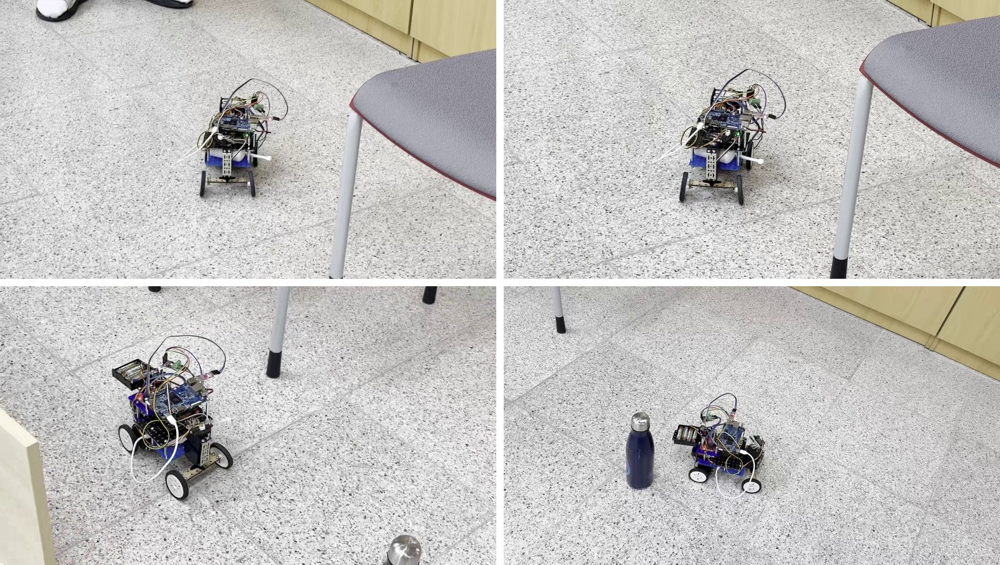
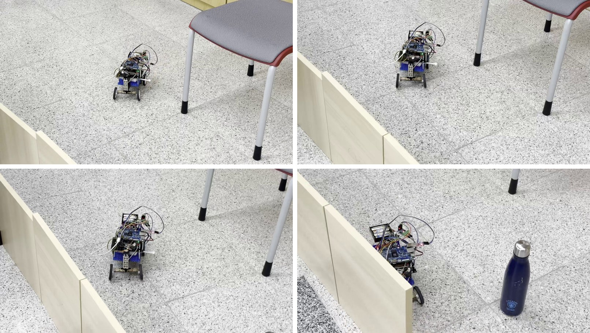

# 원의 접선에서 출발한 사전 지도 없는 자율주행 경로 탐색 알고리즘 설계와 오차 요인 분해

> 한글(hwp)로 옮길 원고. 장마다 복사해서 옮긴다.
> 전체 20쪽 이하. 쪽수 배분(목표): 표지·목차 2 / I 서론 3 / II-1 선행 연구 3 / II-2 방법 5 / II-3 결과 4 / II-4 분석 2 / III 결론 1

---

# I. 서론

## 1. 연구의 목적 및 필요성

### 가. 연구의 필요성

오늘날의 자율주행 자동차는 미리 만들어 둔 정밀 지도와 값비싼 센서에 크게 기대어 움직인다. 그러나 재난 현장, 처음 들어가는 실내, 물건 배치가 자주 바뀌는 창고처럼 지도를 미리 만들 수 없는 곳도 많다. 이런 곳에서 움직이는 로봇은 지금 센서에 보이는 만큼만 알고 출발해야 하며, 달리는 동안 새로 보이는 장애물을 반영하여 경로를 계속 고쳐야 한다.

본 연구에서 "사전 지도"는 출발 전에 미리 주어지는, 장애물의 위치가 모두 담긴 지도를 말한다. 본 연구의 차량은 사전 지도를 받지 않지만 지도가 아예 없는 것은 아니다. 달리는 동안 거리 센서로 잰 값을 칸마다 칠해 "주행 지도"(점유 격자)를 스스로 만들고, 그 지도 위에서 경로를 찾는다. 즉 "사전 지도 없는 주행"은 지도 없이 달리는 것이 아니라, 지도를 만들어 가며 달리는 것이다.

이처럼 사전 지도 없이 길을 찾는 방법은 컴퓨터 화면 안에서는 잘 동작하는 경우가 많다. 그러나 같은 방법을 실제 차량에 옮기면 계획한 길과 실제로 달린 길이 어긋난다. 이 어긋남에는 여러 원인이 섞여 있다. 알고리즘이 아직 보지 못한 장애물을 빈 땅으로 여겨서 생길 수도 있고, 거리 센서가 장애물을 잘못 재서 생길 수도 있으며, 바퀴와 모터가 명령대로 움직이지 않아서 생길 수도 있다. 원인이 섞인 채로 "실제 차가 기둥에 닿았다"는 결과만 보면 알고리즘, 센서, 차체 중 어디를 고쳐야 하는지 알 수 없다.

따라서 사전 지도 없는 경로 탐색 알고리즘을 만드는 것에서 그치지 않고, 실제 주행에서 생긴 오차를 원인별로 나누어 각 원인이 얼마만큼의 몫을 차지하는지 재는 방법이 필요하다. 또한 이 과정이 고등학생이 구할 수 있는 저렴한 부품(거리 센서 한 개, 소형 컴퓨터 보드)으로도 가능한지 확인할 필요가 있다.

### 나. 연구의 목적

본 연구의 목적은 다음 두 가지이다.

첫째, 사전 지도 없이 센서 정보만으로 목적지까지 가는 경로 탐색 알고리즘을 설계한다. 출발점은 고등학교 공통수학2에서 배우는 원과 접선의 성질이다. 장애물을 원으로 보고 원의 접선을 따라 비켜 가는 기하 모델에서 시작하여, 그 한계를 실험으로 확인하고 차량이 실제로 그릴 수 있는 경로만 만드는 방식으로 발전시킨다. 경로 계산은 실제 차량의 계산 보드에서 0.1초 안에 끝나야 한다.

둘째, 실제 주행에서 생긴 오차를 **알고리즘, 센서, 기계(위치 추정 포함)** 세 가지 원인으로 나누어 각각의 크기를 측정한다. 같은 지도에서 조건을 하나씩만 실제에 가깝게 바꾸어 가며 주행시키고, 앞 단계보다 결과가 달라진 만큼을 그 원인의 몫으로 본다.

## 2. 연구 내용

본 연구는 다음 순서로 진행하였다. 각 단계의 구체적인 방법과 결과는 본론에서 다룬다.

**가. 원의 접선을 이용한 기하 모델 설계**
장애물을 원으로, 차량을 크기 없는 점으로 본다. 이를 위해 장애물의 반지름에 차량 폭의 절반을 더해 원을 부풀린다. 목적지로 가는 직선이 원을 지나는지는 판별식과 수선의 발로 판단하고, 원을 지나면 "접선, 원의 호, 접선"으로 이루어진 우회로 중 짧은 쪽으로 비켜 간다.

**나. 기하 모델의 한계 확인과 탐색 방식의 전환**
무작위로 만든 장애물 배치 1000개에서 기하 모델을 시험하여, 부풀린 원끼리 겹칠 때 실패한다는 것을 확인하였다. 이어서 모든 접점을 연결한 그래프에서 최단 경로를 찾는 방식(접선 그래프)으로 확장하였다. 그러나 이 방식은 차량이 실제로 돌 수 있는 최소 회전 반경과 통로 폭을 함께 다루지 못하는 근본적인 한계가 있었다. 그래서 차량의 위치와 방향을 함께 다루며 차가 실제로 그릴 수 있는 곡선 조각만 이어 붙이는 격자 기반 탐색(하이브리드 A\*)으로 바꾸었다.

**다. 시뮬레이터 제작**
세계(장애물), 차량의 움직임, 거리 센서를 수식으로 흉내 내는 시뮬레이터를 만들었다. 시뮬레이터와 실제 차량이 같은 경로 계산 코드를 쓰도록 설계하여, 시뮬레이터에서 확인한 결과를 실제 차량에 그대로 옮길 수 있게 하였다.

**라. 실제 차량에 맞춘 조정**
제작한 차량(길이 22 cm, 폭 12 cm)의 크기와 센서 성능을 재어 시뮬레이터 설정을 맞추었다. 차량에는 계산을 맡는 소형 컴퓨터(Orange Pi 5), 모터와 센서를 맡는 마이크로컨트롤러(Arduino Nano), 서보 모터로 좌우를 훑는 적외선 거리 센서(Sharp GP2Y0A21, 측정 범위 10~80 cm) 한 개, 방향을 재는 자이로 센서(MPU6050)를 달았다. 바퀴 회전수를 세는 장치(엔코더)는 없으므로 차량의 위치는 보낸 속도 명령과 자이로 값으로 추정한다.

**마. 오차 요인 분해**
같은 지도에서 "지도를 처음부터 다 아는 차", "보이는 것만 아는 차", "실제 센서를 흉내 낸 차", "위치를 추정하는 차", "실제 차"를 차례로 주행시키고, 단계마다 달라진 만큼을 알고리즘, 센서, 위치 추정, 기계의 몫으로 나눈다.

## 3. 기대 효과 및 활용 방안

### 가. 기대 효과

**1) 저렴한 센서 하나로 가능한 범위의 확인**
360도를 한 번에 보는 레이저 센서(라이다) 없이, 서보 모터로 좌우를 훑는 거리 센서 한 개만으로 사전 지도 없는 주행이 어디까지 가능한지 확인할 수 있다.

**2) 원인별 오차 크기의 제시**
"실제 차는 시뮬레이션보다 못하다"는 막연한 결론 대신, 오차 중 알고리즘, 센서, 기계가 각각 얼마를 차지하는지 숫자로 제시한다. 이를 통해 성능을 높이려면 어느 부분에 먼저 시간과 비용을 들여야 하는지 판단할 수 있다.

**3) 측정 기준이 결론을 바꾼다는 사례 제시**
같은 주행이라도 무엇을 기준으로 재느냐에 따라 결론이 달라진다. 예를 들어 차량의 뒷바퀴 축 한 점만 보고 충돌을 판정하면 "충돌 없음"이던 주행이, 차체 전체로 판정하면 기둥에 5 cm 파고든 것으로 나왔다. 또한 경로 길이만 지표로 쓰면 "사전 지도가 없는 차가 더 짧게 간다"는 잘못된 결론이 나왔다. 본 연구는 길이, 차체와 장애물 사이의 최소 여유, 목적지 도달 오차를 함께 보는 방식을 제시한다.

### 나. 활용 방안

**1) 교육용 자율주행 실습 자료**
수학 시간에 배우는 접선에서 출발하여 실제 로봇까지 이어지는 과정이므로, 단계별 실습 자료로 쓸 수 있다. 시뮬레이터와 실제 차량이 같은 코드를 쓰므로 실물 없이도 먼저 실습할 수 있다.

**2) 소형 실내 이동 로봇의 기초 자료**
미리 지도를 만드는 과정 없이 동작하므로, 저가 실내 배달 로봇이나 청소 로봇처럼 환경이 자주 바뀌는 로봇의 기초 자료로 쓸 수 있다.

**3) 오차 분해 방법의 다른 로봇 적용**
조건을 하나씩만 바꾸어 원인별 몫을 재는 방법은 경로 탐색이 아닌 다른 로봇 문제(팔 로봇의 위치 오차, 드론의 자세 오차 등)에도 그대로 적용할 수 있다.

---

# II. 본론

## 1. 선행 연구 및 이론적 배경

### 가. 선행 연구 요약

Steven M. LaValle(2006)은 『Planning Algorithms』에서 로봇이나 차량이 놓일 수 있는 위치와 방향을 하나의 공간 위의 점으로 나타내는 **구성 공간(Configuration Space)** 개념을 체계적으로 정리하였다. 구성 공간에서는 차량의 크기와 모양이 장애물 쪽으로 옮겨 가므로, 차량을 크기 없는 점으로 보고 경로를 계산할 수 있다. LaValle은 이를 바탕으로 **비홀로노믹(Non-holonomic) 제약**을 가진 차량의 경로 계획을 다루었다. 비홀로노믹 제약이란 자동차처럼 바퀴가 옆으로 미끄러지지 않아 옆 방향으로 곧바로 움직일 수 없고, 최소 회전 반경보다 작게 돌 수 없는 성질을 말한다. 이런 차량은 지도 위의 두 점을 직선으로 잇는 것만으로는 경로가 되지 않으며, 실제로 그릴 수 있는 곡선으로 이어야 한다. 또한 LaValle은 센서로 얻는 정보가 불완전한 상황을 다루기 위해 로봇이 지금까지 관측한 정보 전체를 상태로 삼는 **정보 공간(Information Space)** 개념을 제시하였고, 무작위로 점을 뿌려 나무 모양으로 탐색 범위를 넓혀 가는 **RRT(Rapidly-exploring Random Tree)** 같은 표본 추출 기반 탐색 기법으로 차원이 높고 복잡한 상태 공간에서도 경로를 효율적으로 찾을 수 있음을 보였다.

Howie Choset 외(2005)는 『Principles of Robot Motion』에서 사전 지도 정보가 충분하지 않은 환경에서 로봇이 센서 측정값에 의존해 움직이는 방법들을 정리하였다. 이 책은 장애물을 만나면 그 경계를 따라 돌다가 목표 쪽으로 다시 떠나는 **Bug 알고리즘** 계열, 장애물들로부터 같은 거리에 있는 점들을 이어 가장 안전한 길을 만드는 **일반화 보로나이 그래프(GVG)**, 공간을 여러 구역으로 나눈 뒤 구역 사이의 연결을 탐색하는 **셀 분할(Cell Decomposition)** 방식, 목표 지점은 로봇을 끌어당기고 장애물은 밀어내는 가상의 힘으로 움직이게 하는 **잠재장(Potential Fields)** 기법을 다루었다. 이 중 Bug 알고리즘과 GVG는 센서로 보이는 정보만으로 달리면서 경로를 만들 수 있어 지도 없는 실시간 주행의 기초가 된다.

### 나. 본 연구와의 관계

본 연구에서 사용한 방법들은 다음 선행 연구에 바탕을 둔다.

| 본 연구에서 사용한 방법 | 바탕이 된 선행 연구 |
|---|---|
| 원의 접선을 이용한 기하 모델 | Bug 알고리즘(Lumelsky, Stepanov, 1987), TangentBug(Kamon 외, 1998) |
| 위치와 방향을 함께 다루는 격자 탐색 | 하이브리드 A\*(Dolgov 외, 2008) |
| 센서 측정값으로 지도 칠하기 | 점유 격자(Elfes, 1989) |
| 계획한 경로 따라가기 | 순수 추종(Pure Pursuit)(Coulter, 1992) |

**1) 원의 접선을 이용한 기하 모델과 Bug 알고리즘**
처음 설계한 기하 모델은 장애물을 만나면 접선과 호를 따라 비켜 가고, 처음 부딪힌 곳보다 목표에 가까워졌을 때만 장애물을 떠난다. 이는 Lumelsky와 Stepanov(1987)의 Bug2 알고리즘이 출발점과 목표를 잇는 직선 위로 돌아왔을 때 장애물을 떠나는 규칙과 같은 생각이다. 또한 거리 센서로 본 장애물의 접점을 향해 곧장 비켜 가는 방식은 TangentBug(Kamon 외, 1998)와 닮았다. 본 연구는 처음에 이 연구들을 모르고 교과서의 판별식과 접선의 방정식만으로 모델을 세웠고, 실험 뒤 조사 과정에서 같은 계열임을 확인하였다.

**2) 위치와 방향을 함께 다루는 격자 탐색과 하이브리드 A\***
Dolgov 외(2008)는 2007년 미국 국방고등연구계획국(DARPA)의 도시 자율주행 대회(Urban Challenge)에 참가한 스탠퍼드 대학 자율주행차의 경로 계획에 하이브리드 A\*를 사용하였다. 일반적인 A\* 탐색은 격자 칸의 중심만 이어서 차가 따라갈 수 없는 꺾인 경로를 만든다. 하이브리드 A\*는 격자로 탐색 범위를 줄이면서도 각 칸 안에서 차의 실제 위치와 방향을 함께 기억하고, 차가 실제로 그릴 수 있는 곡선 조각만 이어 붙인다. 본 연구는 접선 모델이 최소 회전 반경과 통로 폭을 함께 다루지 못한다는 한계를 확인한 뒤 이 방법으로 바꾸었고, 길이 22 cm의 소형 차량과 앞쪽 거리 센서 한 개에 맞게 탐색 간격과 안전 여유를 조정하였다.

**3) 센서 측정값으로 지도 칠하기와 점유 격자**
Elfes(1989)는 공간을 작은 칸으로 나누고, 거리 센서가 측정할 때마다 각 칸이 막혀 있을 가능성을 조금씩 높이거나 낮추는 점유 격자 방식을 제안하였다. 한 번의 측정을 그대로 믿지 않고 여러 번의 측정을 누적하므로 센서 잡음에 강하다. 본 연구도 이 방식으로 지도를 만들었으며, 적외선 거리 센서의 빛이 퍼지는 폭을 고려하여 측정 방향 주변의 칸들을 함께 칠하였다.

**4) 계획한 경로 따라가기와 순수 추종**
Coulter(1992)가 정리한 순수 추종 방법은 차량 앞쪽 일정 거리에 있는 경로 위의 점을 목표로 삼아 그 점을 향하는 원호를 그리도록 조향각을 정한다. 경로의 꼭짓점을 그대로 밟을 때보다 조향이 부드럽다. 본 연구는 속도에 따라 앞을 보는 거리를 바꾸는 방식으로 이를 사용하였다.

**5) 본 연구의 차별점**
위 선행 연구들은 각각 경로 탐색, 지도 작성, 경로 추종의 방법을 제시하였다. 본 연구는 이 방법들을 저렴한 거리 센서 한 개와 소형 보드로 이루어진 차량에 함께 옮기고, 실제 주행에서 생긴 오차를 알고리즘, 센서, 기계의 몫으로 나누어 측정한다는 점에서 차이가 있다.

## 2. 연구 방법

### 가. 원의 접선을 이용한 기하 모델

**1) 모델의 가정**
장애물은 원기둥, 차량은 크기 없는 점으로 본다. 차량의 크기를 없애는 대신 장애물의 반지름에 차량 폭의 절반을 더해 원을 부풀린다. 그러면 점이 부풀린 원 밖에 있는 한 실제 차체도 장애물에 닿지 않는다.

**2) 막힘 판단**
현재 위치에서 목적지까지 그은 선분이 부풀린 원을 지나는지 확인한다. 직선과 원의 방정식을 연립한 이차방정식의 판별식이 0보다 크면 직선이 원과 만난다. 그러나 판별식은 직선 전체를 보므로 차량 뒤쪽에 있는 원도 막힌 것으로 판단한다. 그래서 원의 중심에서 직선에 내린 **수선의 발**이 선분 위에 있는지 함께 확인한다.

**3) 접선과 우회로**
원 밖의 점 (x₀, y₀)에서 중심이 (p, q)이고 반지름이 r인 원에 그은 접선의 기울기 m은, a = p − x₀, b = q − y₀라 할 때 다음 이차방정식의 두 근이다.

(a² − r²)m² − 2abm + (b² − r²) = 0

a² = r²이면 접선 하나가 수직선이므로 따로 처리한다. 접점은 원의 중심에서 접선에 내린 수선의 발이다. 차량은 "접선 → 원의 호 → 접선"으로 이루어진 좌우 두 우회로 중 짧은 쪽을 고른다. 호의 길이는 (원 둘레) × (중심각 / 360°)로 계산하고, 길이가 같으면 오른쪽으로 돈다.

**4) 원을 떠나는 조건**
원을 따라 돌다가, 원의 중심에서 "현재 위치-목적지" 직선에 내린 수선의 발이 차량 뒤로 넘어가면 원을 떠난다. 또한 같은 원 주위를 무한히 도는 것을 막기 위해, 처음 원에 부딪힌 곳보다 목적지에 가까울 때만 떠나게 한다.

**5) 시험 방법**
가로세로 1.5 m 평면에 지름 60~100 mm 기둥 3~6개를 무작위로 놓은 배치 1000개와, 일부러 어렵게 만든 고정 배치 6개(기둥 하나, 직선 위의 기둥, 흩어진 기둥, 붙은 기둥 둘, 벽처럼 늘어선 기둥, 컵 모양)에서 도착 여부와 경로 길이를 측정하였다.

### 나. 접선 그래프 탐색

기하 모델은 눈앞의 원 하나만 보고 판단한다. 이를 여러 원으로 넓히기 위해, 출발점과 목적지와 모든 원의 접점을 역으로, 그 사이를 잇는 접선과 호를 노선으로 삼아 지하철 노선도와 같은 그래프를 만들었다. 이 그래프에서 A\* 탐색으로 비용이 가장 작은 경로를 찾는다. A\* 탐색은 "지금까지 온 거리 + 목적지까지 남은 거리의 추정값"이 작은 역부터 먼저 살펴보는 탐색 방법이다. 경로 비용에는 이동 거리에 더해 장애물에 가까울수록 커지는 벌점, 방향을 많이 바꿀수록 커지는 벌점을 넣었다. 이후 시뮬레이터에서 주행시키며 문제가 드러날 때마다 원인을 찾아 고치고, 고치기 전과 후를 같은 조건에서 비교하였다.

### 다. 위치와 방향을 함께 다루는 격자 탐색 (하이브리드 A\*)

접선 그래프의 근본적인 한계(결과 다절 참고)를 확인한 뒤, 탐색 방식을 다음과 같이 바꾸었다.

**1) 상태와 경로 조각**
탐색의 상태는 위치 (x, y)와 차량의 방향 θ이다. 한 상태에서 다음 상태로 갈 때는 핸들을 왼쪽 끝, 가운데, 오른쪽 끝 등 몇 가지로 꺾은 채 일정 거리를 달린 곡선 조각만 쓴다. 그래서 만들어진 경로는 차량이 실제로 그릴 수 있는 곡선만으로 이루어진다. 같은 칸, 같은 방향 구간에 이미 더 싸게 도착한 상태가 있으면 새 상태는 버려 탐색량을 줄이지만, 상태가 기억하는 위치와 방향은 칸의 중심으로 반올림하지 않은 실제 값이다.

**2) 지도와 충돌 판정**
지도는 한 칸이 4 cm인 점유 격자이다. 센서가 거리를 잴 때마다 빛이 지나간 칸은 "비었음" 쪽으로, 빛이 닿은 끝의 칸들은 "막힘" 쪽으로 값을 조금씩 옮긴다. 지도에서 각 칸이 가장 가까운 장애물까지 얼마나 떨어져 있는지를 미리 계산해 두고(거리장), 차체를 원 세 개로 덮어 각 원의 중심에서 거리장 값이 원의 반지름보다 큰지로 충돌을 판정한다. 뒷바퀴 축 한 점이 아니라 차체 전체로 판정하는 것이다.

**3) 다시 탐색하는 조건**
경로를 0.1초마다 처음부터 다시 찾지 않고, 앞쪽 경로가 새로 본 장애물에 막혔을 때, 차량이 경로에서 일정 거리 이상 벗어났을 때, 일정 시간이 지났을 때만 다시 찾는다. 시간이 지나 찾은 새 경로는 남은 경로보다 15% 이상 쌀 때만 바꾸어, 경로가 자꾸 바뀌어 차가 흔들리는 것을 막는다.

**4) 경로 따라가기와 예측 정지**
조향각은 순수 추종 방법으로 정한다(초당 50회). 또한 지금 명령대로 달리다 멈출 때까지 가는 거리만큼 앞에서 차체가 장애물에 닿을 것으로 예측되면 즉시 멈추고 다시 탐색한다.

### 라. 시뮬레이터

실제 차량은 한 번 시험하는 데 시간이 오래 걸리고 같은 조건을 반복할 수 없다. 그래서 다음 세 가지를 수식으로 흉내 내는 시뮬레이터를 Python으로 만들었다.

| 구성 | 흉내 내는 방법 |
|---|---|
| 세계 | 원기둥 장애물과 벽. 무작위 배치를 번호로 다시 만들 수 있어 같은 조건을 반복할 수 있다 |
| 차량 | 자전거 모델(앞바퀴 하나, 뒷바퀴 하나로 단순화한 자동차 운동 모델). 최대 조향각, 조향 속도, 가속과 감속의 한계를 둔다 |
| 센서 | 지정한 방향으로 빛을 쏘아 가장 가까운 장애물까지의 거리를 계산하고, 빛의 퍼짐과 측정 잡음을 더한다 |

시뮬레이터와 실제 차량은 같은 경로 탐색 코드를 쓴다. 실제 차량에서는 마이크로컨트롤러와 주고받는 통신 대신, 같은 형식으로 말하는 "가짜 마이크로컨트롤러" 프로그램을 끼우면 실제 주행 코드를 그대로 시뮬레이터에서 돌릴 수 있다.

### 마. 실제 차량의 구성

**1) 부품과 역할 분담**

| 부품 | 역할 |
|---|---|
| Orange Pi 5 (소형 컴퓨터) | 지도 작성, 경로 탐색(초당 10회), 경로 따라가기(초당 50회) |
| Arduino Nano (마이크로컨트롤러) | 모터, 조향 서보, 센서 서보 제어, 센서 읽기, 비상 정지 |
| Sharp GP2Y0A21 (적외선 거리 센서) | 서보 위에서 좌우 ±75°를 15°씩 훑으며 10~80 cm 측정 |
| MPU6050 (자이로 센서) | 차량이 도는 빠르기 측정 → 방향 추정 |
| DC 모터 2개, L9110S (모터 드라이버) | 구동 |
| (출발 방법) | 거리 센서 앞 20 cm 안에 손을 2초 대었다 치우면 3초 뒤 출발. 리모컨 수신기는 거리 센서의 전원 잡음으로 가짜 신호를 받아 쓰지 않았다 |

**2) 차량 크기**
전장 22 cm, 전폭 12 cm, 축거(앞뒤 바퀴 사이) 15 cm, 뒷바퀴 축에서 차 뒤끝까지 4 cm, 바퀴 지름 5.5 cm로 측정하였다. 최소 회전 반경과 센서 위치는 재지 못하여, 최대 조향각 32°(최소 회전 반경 약 24 cm)와 시뮬레이터의 기본 센서 위치를 썼다.

**3) 안전 장치**
Orange Pi와 Arduino는 USB 선으로 초당 50회 글자 문장을 주고받는다. 문장 끝에는 검사값을 붙여, 선이 흔들려 글자가 깨진 문장은 버린다. Arduino는 마지막 명령을 받은 지 0.3초가 지나면 Orange Pi의 상태와 상관없이 스스로 모터를 멈춘다(감시 정지). 속도도 Arduino에서 한 번 더 제한한다.

**4) 위치 추정**
바퀴 회전수를 세는 엔코더가 없으므로, "보낸 속도 × 시간"으로 이동 거리를, 자이로 값으로 방향을 추정한다. 따라서 실제 속도가 명령과 다르면 위치 오차가 계속 쌓인다. 실제 차량에서는 자이로 판이 고장 나, 자전거 모델에 따라 "이동 거리 × tan(조향각) ÷ 축거"로 방향 변화를 계산하였다. 이 방법은 바퀴가 미끄러지거나 조향 서보가 명령만큼 꺾이지 않으면 방향 오차가 쌓이며, 이동 거리 오차가 방향 오차로도 이어진다.

**5) 차량 크기에 맞춘 설정**
시뮬레이터의 기본 차량(전장 48 cm, 전폭 28 cm)에 맞춰 두었던 설정을 실제 차량에 맞게 줄였다. 탐색 조각 길이는 40 cm에서 16 cm로, 도착 판정 반경은 30~45 cm에서 6~8 cm로 줄였다. 또한 모터가 너무 약한 명령에서는 돌지 않고 소리만 나는 성질(바닥에서 모터 힘 255 중 120 미만)을 반영하여, 그보다 약한 명령은 움직이는 최소 힘으로 올리고 그 힘에서의 실제 속도를 계산 보드에 알리게 하였다.

### 바. 실험 방법

**1) 가상 시험장 실험**
실제 시험 공간과 같은 1.5 m × 1.5 m 평면에 지름 8 cm 기둥 3~6개를 무작위로 놓은 배치 30개를 만들었다. 차량 범퍼 앞 40 cm 안에는 기둥을 놓지 않는다. 뒤 센서가 없어 후진하지 않으므로, 범퍼 바로 앞의 기둥은 피할 방법이 없기 때문이다. 각 배치에서 실제 주행 코드를 가짜 마이크로컨트롤러와 함께 돌려 도착 여부, 차체와 기둥 사이의 최소 여유, 멈춘 곳과 목적지 사이의 거리를 쟀다.

**2) 오차 분해 실험**
같은 배치, 같은 출발점과 목적지에서 다음 단계를 차례로 주행시킨다. 단계마다 한 가지만 실제에 가깝게 바꾸고, 앞 단계보다 결과가 달라진 만큼을 그 원인의 몫으로 본다.

| 단계 | 바꾼 것 | 앞 단계와의 차이 = 몫 |
|---|---|---|
| 0 다 아는 차 | 지도를 처음부터 다 앎, 위치 추정 완벽 | (기준) |
| 1 보이는 것만 아는 차 | 센서에 보인 것만 앎. 센서는 이상적(1° 간격, 잡음 없음) | 알고리즘 |
| 2 실제 센서 | 서보로 15°씩 훑음, 빛의 퍼짐, 측정 잡음 | 센서 |
| 3 위치 추정 | 엔코더 없이 명령 속도와 자이로로 위치 추정 | 위치 추정 |
| 4 실제 차 | 실제 차량을 달려 바닥에 궤적을 남김 | 기계와 제어 |

**3) 평가 지표**
처음에는 계획서대로 "경로 길이 비"를 주 지표로 정하였다. 그러나 예비 실험에서 이 지표가 틀린 결론을 내는 것을 확인하였다(결과 마절 참고). 그래서 다음 세 지표를 항상 함께 본다.
- **경로 길이 비**: 다 아는 차가 달린 길이에 대한 비
- **차체 최소 여유**: 달리는 동안 차체 둘레와 실제 장애물 사이가 가장 가까웠던 거리. 음수이면 닿은 것이다.
- **도달 오차**: 차량이 도착했다고 멈춘 순간의 실제 위치와 목적지 사이 거리

## 3. 연구 결과

### 가. 원의 접선을 이용한 기하 모델

| 배치 | 결과 | 경로 길이 / 직선 거리 |
|---|---|---|
| 기둥 하나 | 도착 | 1.006 |
| 중심이 직선 위에 있는 기둥 | 도착(오른쪽 규칙) | 1.011 |
| 흩어진 기둥 다섯 | 도착 | 1.027 |
| 붙은 기둥 둘 | 충돌 | - |
| 벽처럼 늘어선 기둥 | 충돌(좌우를 57번 바꿈) | - |
| 컵 모양 | 충돌(좌우를 87번 바꿈) | - |
| 무작위 1000개 | 도착 981, 충돌 16, 멈춤 3 | 평균 1.009 |

부풀린 원끼리 겹치지 않는 배치 415개는 모두 도착하였고, 실패한 19개는 모두 원이 겹친 배치였다. 원이 겹치면 한 원의 접점이 옆 원 안에 묻히는데, 원 하나만 보는 규칙은 이를 모르고 그 접점으로 향하였다. 또한 계획서의 규칙만으로는 원을 떠나는 순간 차량이 원 위에 서 있어 그 원에 다시 접선을 그을 수 없는 경우가 생겨, 1000개 중 94개가 멈추었다. "떠나려던 원이 다시 길을 막으면 계속 따라 돈다"는 규칙을 더해 이를 해결하였다. 손으로 계산한 "접선 + 호 + 접선" 길이와 시뮬레이터에서 실제로 달린 길이는 소수 셋째 자리까지 같았다.

### 나. 접선 그래프 탐색의 개선 과정

| 문제 | 원인 | 해결 | 결과 |
|---|---|---|---|
| 계획 한 번에 2,253 ms | 노선 5,709개를 모두 미리 충돌 검사 | 탐색이 실제로 꺼낸 노선만 검사 | 24 ms(약 90배 빠름), 경로 비용 동일 |
| 경로를 너무 자주 바꿈 | 기존 경로는 옛 위치에서, 새 경로는 지금 위치에서 비용을 재어 비교 | 기존 경로 비용을 지금 위치 기준으로 맞춤 | 경로 교체 36회 → 14회(pillars), 70회 → 10회(narrow) |
| 차 뒤로 되돌아가는 경로 | 탐색이 차의 방향을 모름 | 뒤로 가는 첫 구간에 큰 벌점 | 되돌아가기 30회 → 0회, 주행 41.3초 → 18.0초(walls) |

세 번째 문제는 해결까지 세 번 시도하였다. 반대쪽 우회로를 아예 만들지 않는 방법은 멀쩡한 우회로까지 막아 주행 시간이 늘었고, 뒤로 가는 첫 구간을 금지하는 방법은 막다른 골목에서 빠져나오지 못하였다. 금지 대신 벌점을 주는 방법이 두 경우를 모두 해결하였다. 벌점 크기를 12, 30, 60, 120으로 바꾸어 보았을 때 어중간한 벌점(30, 60)이 가장 나빴다.

### 다. 접선 그래프의 근본적 한계와 탐색 방식의 전환

남은 문제들은 고쳐서 없앨 수 있는 오류가 아니라 방법 자체의 한계였다.

- **좁은 틈을 지나지 못함.** 접선 그래프에서는 원의 호가 곧 차량이 지나는 길이다. 차가 그 호를 따라 돌 수 있도록 부풀림 반지름을 최소 회전 반경 이상(0.85 m)으로 키워야 했고, 그 결과 폭 28 cm인 시뮬레이터 차량이 1.69 m보다 좁은 틈을 지나지 못하였다. 장애물을 피하는 여유와 회전 반경을 하나의 값으로 묶은 구조 때문이다.
- **차체 접촉을 놓침.** 시뮬레이터의 충돌 판정은 뒷바퀴 축 한 점만 보았다. 차체 전체로 다시 재자 "충돌 0건"이던 주행에서 기둥에 5 cm 파고든 경우가 나왔다.

위치와 방향을 함께 다루는 격자 탐색으로 바꾼 뒤, 회전 반경은 곡선 조각에만 들어가고 통로 폭은 차체 원으로 따로 판정하게 되어 지나갈 수 있는 최소 틈이 **1.69 m에서 0.7 m**로 줄었다. 이 과정에서 목적지까지 남은 거리의 추정값이 벽을 뚫고 계산되어 골목 안에서 탐색이 헤매는 오류(추정 13.0 m, 실제 26.2 m)를 찾아 고쳤고, 고친 뒤에는 386번의 확장만에 골목을 빠져나가는 경로를 찾았다.

### 라. 가상 시험장 실험 (실제 차량 크기)

| 설정 | 도착 | 기둥에 닿음 | 가장 가까이 간 거리 | 멈춘 곳과 목적지 거리 |
|---|---|---|---|---|
| 시뮬레이터 기본 차량 설정 그대로 (배치 10개) | 8 | 2 | - | 약 43 cm 앞에서 멈춤 |
| 실제 차량에 맞춘 설정, 센서 ±90° (배치 30개) | 28 | 0 | 1.5 cm | 4~9 cm |
| 실제 차량에 맞춘 설정, 센서 ±75° (배치 30개) | 27 | 0 | 5.3 cm | 평균 8.2 cm (1.8~14.5 cm) |
| 위 설정에서 자이로 없이 조향각으로 방향 추정 (배치 30개) | 26 | 0 | 5.5 cm | 평균 8.2 cm (7.6~9.0 cm) |

기본 설정에서는 도착 판정 반경이 차량 길이의 두 배쯤이라 목적지 한참 앞에서 멈추었고, 탐색 조각이 시험장에 비해 너무 길어 기둥 사이를 지나지 못하였다. 설정을 줄인 뒤 30개 중 28개에 도착하였으며, 한 번도 기둥에 닿지 않았다. 도착하지 못한 2개는 기둥 사이 틈이 좁아 지나갈 경로를 찾지 못하고 멈춘 경우로, 후진하지 않는 차량이므로 정상적인 정지이다. 센서가 차량 위의 보드에 닿아 훑는 범위를 ±75°로 줄였을 때도 도착이 1개 줄었을 뿐 접촉은 없었다. 자이로 없이 조향각으로 방향을 추정해도 도착이 1개 더 줄었을 뿐 접촉은 없었다. 다만 가상 시험장은 바퀴가 미끄러지지 않으므로, 실제 차량에서는 이 방법의 방향 오차가 더 클 것이다. 실제 차량의 계산 보드에서 경로 탐색 한 번은 평균 8.3 ms로, 목표인 0.1초 안에 충분히 끝났다(시뮬레이터 기본 차량 설정으로 측정).

### 마. 오차 분해 예비 실험 (시뮬레이터 기본 차량)

실제 차량의 치수를 재기 전, 시뮬레이터 기본 차량(전폭 28 cm)과 3 m 레이저 센서 모델로 무작위 배치 30개에서 오차 분해를 먼저 실행하였다.

| 원인 | 경로 길이 비 변화 | 차체 최소 여유 변화 | 도달 오차 변화 | 위치 추정 오차 |
|---|---|---|---|---|
| 알고리즘 | -2.1% | **-6.4 cm** | 0 | 0 |
| 센서 | **+7.6%** | +7.0 cm | 0 | 0 |
| 위치 추정 | -2.8% | -0.3 cm | **+30.5 cm** | +41.6 cm |

- **알고리즘의 몫**: 보이는 것만 아는 차는 아직 못 본 기둥을 빈 땅으로 여겨 바짝 붙어 간다. 길이는 짧아지지만 여유를 6.4 cm 잃는다.
- **센서의 몫**: 빛이 퍼져서 기둥이 실제보다 크게 기록된다. 그만큼 크게 돌아 길어지지만 오히려 안전해진다.
- **위치 추정의 몫**: 엔코더가 없어 엉뚱한 곳에서 도착했다고 멈춘다. 길이는 오히려 짧아질 수 있어 길이 지표로는 드러나지 않는다.

이 예비 실험에서 계획서의 주 지표였던 경로 길이 비가 틀린 결론을 낸다는 것을 확인하였다. 배치 12개 중 8개에서 다 아는 차가 보이는 것만 아는 차보다 더 길게 달렸다. 탐색이 줄이는 것은 길이가 아니라 장애물 근처 벌점을 포함한 비용이므로, 다 아는 차는 좁은 틈을 피해 넓게 돌아간 것이다. 길이만 보면 "사전 지도가 없는 것이 낫다"는 결론이 나온다.

이 예비 실험은 실제 차량보다 큰 기본 차량과 레이저 센서 모델로 한 것이므로, 각 원인의 몫의 크기보다는 "원인마다 드러나는 지표가 다르다"는 성질을 보여 주는 결과로 본다. 실제 차량 크기와 적외선 센서 모델로 다시 실행하는 것은 후속 연구로 남긴다.

### 바. 실물 이식 과정에서 발견한 오차 원인

시뮬레이터에서 통과한 코드를 실제 차량에 옮기면서, 시뮬레이터에는 없던 다음 문제들을 발견하였다. 모두 실제로 달리기 전에, 실제 주행 코드를 가상 시험장에서 돌린 결과와 차량이 남긴 기록을 분석하여 찾아냈다.

| 발견한 문제 | 영향 | 원인 분류 |
|---|---|---|
| 센서 서보의 회전 방향이 코드의 가정과 반대 | 왼쪽 장애물이 지도의 오른쪽에 기록됨(지도 좌우 반전) | 기계 |
| 거리를 잰 방향 대신 다음에 잴 방향을 함께 보고 | 장애물이 지도에 15° 틀어져 기록됨 | 알고리즘(구현) |
| 모터를 끈 상태에서도 명령 속도를 그대로 보고 | 서 있는 차를 달리는 것으로 추정 | 위치 추정 |
| 비어 있음을 여러 번, 막힘을 한 점에만 기록 | 가는 기둥이 지도에서 지워져 기둥에 접촉 | 알고리즘(구현) |
| 센서 서보의 좌우 회전량이 다름 | 같은 75° 명령에 왼쪽이 더 돌아 보드에 닿음 | 기계 |
| 자이로 연결이 순간 끊기면 마이크로컨트롤러 전체가 멈춤 | 센서와 통신이 모두 멈춤 | 기계 |
| 거리 센서 신호선이 아날로그 입력(A0)이 아닌 디지털 핀에 꽂힘 | 아무것도 연결되지 않은 입력이 주변 전기를 읽어, 없는 장애물이 25~79 cm에 무작위로 기록되거나 7분 동안 거의 아무것도 못 잼 | 기계(배선) |
| 자이로의 측정 범위를 설정하지 않고 다른 범위의 눈금으로 계산 | 차가 도는 양이 실제의 8배로 계산됨(손으로 90° 돌리자 663°). 가만히 있어도 초당 83° 도는 것으로 추정해 지도가 회전하며 기록되고 길이 모두 막힌 것으로 판단 | 위치 추정 |
| 자이로 판이 뒤집혀 장착됨 | 왼쪽으로 돈 것을 오른쪽으로 돈 것으로 추정 | 기계 |
| 조향 서보의 회전 방향이 코드의 가정과 반대 | 오른쪽 조향 명령에 차가 왼쪽으로 돎. 방향을 바로잡으려 할수록 더 틀어져 차가 나선을 그리며 감겨 들어감 | 기계 |
| 모터 드라이버 전원을 마이크로컨트롤러의 5V(USB 전원)에서 받음 | 모터 힘 100%에서도 초속 약 10 cm. 예상 속도(1.4 m/s)로 위치를 추정해 3 cm 가고 96 cm 갔다고 판단 | 기계(배선) |
| 적외선 거리 센서가 측정할 때마다 전원 전압을 흔듦 | 리모컨 수신기에 초당 17~30회 가짜 신호. 센서 전원을 빼면 초당 4~8회로 줄어듦 | 센서 |
| 자이로 판이 통신선(I2C)을 붙잡아 응답하지 않음 | 방향을 잴 수 없어 출발하지 못함. 판을 빼면 통신선이 정상으로 돌아와 판의 고장으로 판단하고, 자이로 없이 조향각과 이동 거리로 방향을 추정하도록 바꿈 | 센서 |

### 사. 실제 차량 주행

**1) 조건**
교실 바닥에 소화기 2개, 세워 둔 나무판(벽), 의자, 물병을 장애물로 놓고, 손 출발로 차량이 보고 있는 방향 100 cm 앞을 목적지로 주었다. 자이로 판이 고장 나 있었으므로 마이크로컨트롤러가 "속도 × tan(조향각) ÷ 축거"로 회전 빠르기를 계산하여 자이로 값 대신 보냈다. 모터 전원을 건전지로 바꾼 뒤 속도를 다시 재지 못하여, 계산 보드가 믿는 속도와 실제 속도가 다른 상태였다. 조향은 최대 32°와 48° 두 가지로 달렸다. 주행은 약 10분 동안 장애물 배치를 바꾸어 가며 반복하였고 영상으로 기록하였다. 이 실험의 목적은 성공률을 재는 것이 아니라 실제 차량이 어떤 상황에서 왜 실패하는지 찾는 것이다. 그래서 차량이 멈추면 그 원인을 확인한 뒤 장애물 배치를 바꾸어 다시 달렸고, 도착 횟수는 세지 않았다.

**2) 관찰 결과**

| 장면 | 관찰 |
|---|---|
| 소화기 2개 | 정면의 소화기를 왼쪽으로 꺾어 피한 뒤, 두 소화기 사이를 지나 목적지 쪽으로 갔다. 영상에서 접촉은 보이지 않았다. 그러나 같은 소화기를 처음에는 잘 피하다가 주행을 거듭할수록 알아보지 못하는 일이 늘어 장애물을 바꾸었다 |
| 좁은 틈 | 벽이나 원기둥 장애물과의 거리가 차량 폭 정도로 좁으면 "갇힘"으로 판정하고 중간에 멈추는 일이 잦았다 |
| 의자 | 다리 사이를 지나가는 방향으로 놓았을 때 한 번은 다리 사이로 들어가 전진하였다. 위치를 바꾸거나 처음과 같은 위치로 되돌려 다시 시도하였을 때는 같은 결과가 다시 나오지 않았다 |
| 의자 + 벽 + 물병 | 왼쪽에 의자, 오른쪽에 조금 떨어진 벽을 두고, 그 사이를 빠져나온 길목에 물병을 두어 길을 둘로 나누었다. 두 조향각 모두 의자 다리 쪽을 막힌 벽처럼 보고 오른쪽으로 꺾었다. 최대 32°에서는 벽에 부딪히는 경우가 있었고 물병의 오른쪽으로 갔다. 최대 48°에서는 물병의 왼쪽으로 갔으나, 그 뒤 계속 왼쪽으로 돌다가 의자 다리에 부딪혔다 |

## 4. 연구 결과 분석

### 가. 접선 모델이 실패한 이유

접선 모델은 "부풀린 원이 서로 겹치지 않는다"는 조건에서는 1000개 중 겹치지 않은 배치 415개를 모두 통과하였다. 실패는 모두 이 조건이 깨질 때 일어났다. 즉 교과서의 원과 접선은 장애물이 듬성할 때는 충분히 정확한 모델이지만, 장애물이 붙어 있을 때와 차량이 최소 회전 반경을 가질 때는 그대로 쓸 수 없다. 이 한계를 실험으로 확인한 것이 탐색 방식을 바꾸는 근거가 되었다.

### 나. 측정 기준이 결론을 바꾼 사례

본 연구에서는 측정 기준을 바꾸자 결론이 뒤집힌 경우가 두 번 있었다. 뒷바퀴 축 한 점으로 충돌을 판정하면 "충돌 없음"이던 주행이 차체 전체로 판정하면 접촉이었고, 경로 길이만 보면 사전 지도가 없는 차가 더 나았다. 두 경우 모두 지표가 실제로 알고 싶은 것(차체가 닿았는가, 안전하게 도착했는가)의 일부만 보고 있었기 때문이다. 이후 모든 실험에서 길이, 차체 여유, 도달 오차를 함께 보았다.

### 다. 시뮬레이터와 실제 차량의 차이

실물 이식 과정에서 발견한 문제 13개 중 7개는 기계(배선 포함), 2개는 구현, 2개는 센서, 2개는 위치 추정에 속한다. 시뮬레이터는 서보가 정확한 방향으로 정확한 각도만큼 돌고, 부품끼리 전기적으로 간섭하지 않는다고 가정한다. 실제 차량에서는 이 가정이 깨져 지도가 좌우로 뒤집히거나 리모컨 신호가 가짜 신호에 묻히는 등, 알고리즘이 아무리 정확해도 막을 수 없는 오차가 생겼다. 이는 오차 분해에서 "기계"의 몫을 따로 재야 하는 이유를 보여준다.

### 라. 실제 주행에서 드러난 한계

**1) 좁은 틈에서 자주 멈춘 이유**
탐색은 차체를 덮는 원의 중심이 장애물에서 차체 반지름 7 cm에 안전 여유 5 cm를 더한 12 cm 이상 떨어진 경로만 허용한다. 따라서 두 장애물 사이가 24 cm보다 좁으면 지나갈 수 없다고 판단한다. 여기에 지도 칸(4 cm)의 크기와 센서 빛의 퍼짐만큼 장애물이 지도에서 더 두껍게 그려지므로, 실제로는 30 cm 안팎의 틈도 막힌 것으로 보일 수 있다. 이는 차량 폭(12 cm)의 2.5배 정도이다. 차량은 뒤 센서가 없어 후진하지 않으므로, 앞이 막히면 5초 동안 기다린 뒤 갇힘으로 끝난다. 가상 시험장에서 기다리는 시간을 5초, 10초, 20초로 바꾸어도 도착은 30개 중 26개로 같았으므로, 판정이 성급한 것이 아니라 안전 여유와 후진 불가가 함께 만든 결과이다. 안전 여유를 줄이면 더 좁은 틈을 지나겠지만 접촉 위험이 커진다. 이는 안전과 통과 능력 사이의 맞바꿈이다.

**2) 의자 다리를 지나간 결과가 되풀이되지 않은 이유**
의자 다리는 지름 2~3 cm의 가는 기둥이다. 센서는 15°마다 한 번씩 재므로 50 cm 앞에서는 측정 방향 사이가 약 13 cm 벌어진다. 가는 다리는 어떤 훑기에서는 잡히고 어떤 훑기에서는 측정 방향 사이로 빠진다. 또 적외선 센서는 둥글고 매끈한 금속 표면에서 빛이 비스듬히 반사되어 거리를 잘못 재기 쉽다. 출발 위치가 조금만 달라져도 지도에 기록되는 다리의 위치와 두께가 달라지고, 그에 따라 탐색이 고르는 길도 달라진다. 의자 다리를 벽처럼 본 것은 측정 한 번마다 빛이 퍼지는 폭 전체를 막힌 칸으로 칠하는 방식 때문에 가까운 다리들이 지도에서 이어졌기 때문으로 추정된다. 계산 보드에 남은 주행 기록으로 이를 확인하는 것은 후속 연구로 남긴다.

**3) 조향각을 늘렸을 때 다른 길로 간 이유**
계산 보드는 최대 조향각을 32°로 알고 길을 짠다. 48° 시험에서는 계산 보드를 바꿀 수 없어, 마이크로컨트롤러가 조향 명령을 1.5배로 키워 서보를 돌렸다. 그 결과 최소 회전 반경이 계산 보드가 아는 약 24 cm보다 작은 약 14 cm가 되었다. 더 날카롭게 돌 수 있어 32°로는 가지 못한 물병 왼쪽 길로 들어갈 수 있었다. 그러나 경로를 따라가는 제어는 "이만큼 꺾으면 이만큼 돈다"는 32° 기준의 관계로 조향을 정하므로, 실제로는 1.5배 더 돌았다. 방향 오차를 줄이려고 다시 꺾을 때마다 지나치게 돌아 계속 왼쪽으로 감기며 의자 다리에 부딪힌 것으로 보인다. 즉 차량의 실제 성질과 탐색이 아는 모델이 다르면, 성능이 좋아지는 쪽으로 바꾸어도 결과가 나빠질 수 있다. 32°에서 벽에 부딪힌 것은 반대로 회전 반경이 커서 벽 앞에서 충분히 꺾지 못한 경우이다.

**4) 소화기를 갈수록 알아보지 못한 이유**
적외선 거리 센서는 쏜 빛이 물체에 맞고 돌아온 각도로 거리를 잰다. 소화기는 둥글고 광택이 있어, 빛이 정면으로 맞지 않으면 다른 방향으로 반사되어 돌아오지 않는다. 또 이 센서의 출력은 전원 전압에 따라 달라지는데, 이번 주행에서는 계산 보드가 보조배터리로 움직였으므로 배터리가 줄면서 거리 환산이 어긋났을 가능성이 있다. 창으로 들어오는 햇빛의 적외선도 영향을 준다. 이 중 어느 것이 원인인지는 주행 기록의 거리 측정값으로 확인할 수 있으며, 후속 연구로 남긴다.

**5) 정리**
실제 주행의 실패는 모두 알고리즘 자체보다 센서가 장애물을 잘못 보거나, 차량의 실제 성질(회전 반경, 속도)이 탐색이 아는 모델과 다를 때 일어났다. 이는 오차 분해에서 센서와 기계의 몫을 따로 재야 한다는 앞의 결론을 실제 주행으로 다시 확인한 것이다.

---

# III. 결론 및 제언

## 1. 결론

본 연구는 고등학교 수학의 원과 접선에서 출발하여, 사전 지도 없이 센서로 주행 지도를 만들어 가며 목적지까지 가는 경로 탐색 알고리즘을 설계하고 실제 차량에 옮겼다.

첫째, 장애물을 원으로 보고 접선을 따라 비켜 가는 기하 모델은 장애물이 듬성할 때는 정확하였지만, 부풀린 원끼리 겹치거나 차량의 최소 회전 반경을 고려해야 할 때는 실패하였다. 이 한계를 무작위 배치 1000개로 확인하고, 차량이 실제로 그릴 수 있는 곡선만 이어 붙이는 하이브리드 A\* 탐색으로 바꾸었다. 실제 차량 크기의 가상 시험장 30개에서 27개에 도착하고 한 번도 기둥에 닿지 않았으며, 경로 탐색은 실제 계산 보드에서 평균 8.3 ms로 목표인 0.1초 안에 끝났다.

둘째, 오차 분해 예비 실험에서 원인마다 드러나는 지표가 다르다는 것을 확인하였다. 알고리즘의 몫은 차체 여유에, 센서의 몫은 경로 길이에, 위치 추정의 몫은 도달 오차에 주로 나타났다. 따라서 경로 길이 하나만으로 성능을 판단하면 틀린 결론에 이를 수 있으며, 여러 지표를 함께 보아야 한다.

셋째, 실제 차량으로 옮기는 과정에서 시뮬레이터에 없던 문제 13개를 찾았고, 그중 7개가 기계와 배선 문제였다. 실제 주행에서 차량은 소화기를 피해 두 소화기 사이를 지나갔지만, 가는 의자 다리와 둥글고 광택 있는 소화기를 센서가 제대로 보지 못하거나, 차량의 실제 회전 반경이 탐색이 아는 값과 다를 때 실패하였다. 즉 실제 주행의 실패는 탐색 알고리즘보다 센서와 차량 모델의 불일치에서 주로 생겼다. 이는 오차를 원인별로 나누어 보아야 하는 이유를 실제 주행으로 다시 보여 준다.

연구 목적 중 알고리즘 설계와 0.1초 안의 계산은 달성하였다. 오차 분해는 시뮬레이터 안의 세 원인(알고리즘, 센서, 위치 추정)까지 수치로 나누었고, 실제 차량 단계(기계)는 수치 대신 실패 사례의 원인 분석으로 확인하였다.

## 2. 맺는 글 및 고찰

- **속도와 회전 반경 실측**: 모터 전원을 건전지로 바꾼 뒤 속도를 다시 재지 못했고, 최소 회전 반경도 재지 못하였다. 두 값을 재어 계산 보드의 차량 모델을 실제와 맞추면, 조향각을 늘렸을 때 생긴 지나친 회전을 줄일 수 있다.
- **위치 추정**: 엔코더가 없고 자이로가 고장 나 조향각과 명령 속도로만 위치를 추정하였다. 바퀴 회전수를 세는 장치와 새 자이로를 함께 쓰면 위치 오차를 줄일 수 있다.
- **센서**: 15° 간격의 훑기로는 가는 장애물을 놓칠 수 있고, 적외선 센서는 표면의 재질과 전원 전압에 따라 값이 달라진다. 훑는 간격을 줄이거나 다른 방식의 센서를 함께 쓰는 방법을 시험할 수 있다.
- **후진**: 뒤 센서가 없어 막히면 멈출 수밖에 없었다. 뒤 센서를 달면 좁은 틈에서 후진하여 빠져나올 수 있다.
- **주행 기록 분석과 오차 분해 완성**: 계산 보드에 남은 주행 기록으로 의자와 소화기에서의 실패 원인을 확인하고, 실제 차량 크기와 적외선 센서 모델로 오차 분해를 다시 실행하며, 바닥에 궤적을 남겨 기계의 몫을 수치로 재는 것을 후속 연구로 남긴다.

---

# IV. 참고문헌

> 본론을 다 쓰면 이 장을 맨 끝으로 옮긴다. 본문에 인용한 순서가 아니라 저자 이름 순서로 적었다.

1. Choset, H., Lynch, K. M., Hutchinson, S., Kantor, G., Burgard, W., Kavraki, L. E., & Thrun, S. (2005). *Principles of Robot Motion: Theory, Algorithms, and Implementations*. MIT Press.
2. Coulter, R. C. (1992). *Implementation of the Pure Pursuit Path Tracking Algorithm* (Technical Report CMU-RI-TR-92-01). Carnegie Mellon University, Robotics Institute.
3. Dolgov, D., Thrun, S., Montemerlo, M., & Diebel, J. (2008). Practical search techniques in path planning for autonomous driving. *Proceedings of the First International Symposium on Search Techniques in Artificial Intelligence and Robotics (STAIR-08)*. AAAI.
4. Elfes, A. (1989). Using occupancy grids for mobile robot perception and navigation. *Computer*, 22(6), 46-57.
5. Kamon, I., Rivlin, E., & Rimon, E. (1998). TangentBug: A range-sensor-based navigation algorithm. *The International Journal of Robotics Research*, 17(9), 934-953.
6. LaValle, S. M. (2006). *Planning Algorithms*. Cambridge University Press.
7. Lumelsky, V. J., & Stepanov, A. A. (1987). Path-planning strategies for a point mobile automaton moving amidst unknown obstacles of arbitrary shape. *Algorithmica*, 2, 403-430.

**전체 코드와 코드 보고서**
본 연구의 전체 코드(시뮬레이터, 경로 탐색, 차량 펌웨어)와 코드가 바뀌어 온 과정을 정리한 코드 보고서를 아래 저장소에 공개하였다. https://github.com/StarCoder14/Auto_DRIVING

